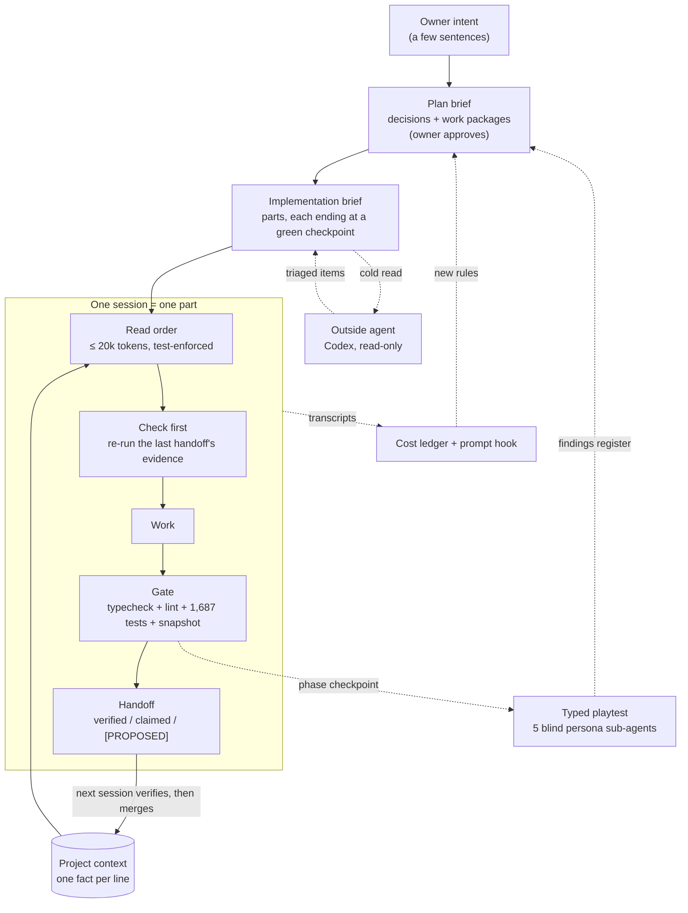

# Orchestrating coding agents on a 45k-line codebase

**In short.** I designed and ran the **harness** that let AI coding agents (Claude Code, with Codex and Gemini as outside reviewers) build *Infinity Autobattler*, a procedural card game, over 207 working sessions in 44 days. The harness keeps short-lived sessions coherent:
- no session's claim enters the shared project state until the next session has re-checked it;
- the checks grow with the risk of a change;
- a ledger measures every session.

Its measurements changed my rules: after one runaway session, a one-package-per-session rule cut average per-session token cost by 58%. The codebase came to 44,966 lines of TypeScript in `src/` and 22,514 lines of tests (1,687 passing). I wrote almost none of that code. This page describes the harness, what it measured, and where it fell short. Every figure comes from [evidence/NUMBERS.md](evidence/NUMBERS.md), which a script regenerates from the repo.

## My role

I worked as the project's designer and tech lead; the agents were the engineers.

- **I decided** what the game is (vision, pillars, what it is *not*), approved every plan before work started, answered the design questions each plan raised, and set which model may do which kind of work. I also changed the process whenever a measurement said it wasn't working: the twelve decisions in [evidence/DECISIONS.md](evidence/DECISIONS.md), each with what prompted it.
- **I delegated** implementation, tests, tooling, the drafting of briefs from my intent, audits and reviews.

Most of my input is intent, not instructions: a few sentences on what I want and why. The harness turns that into a plan with explicit decisions for me to approve, then into briefs specific enough to leave the implementing session few judgment calls. Design conflicts the documents don't settle come to me and are never resolved silently. Smaller calls the session makes itself go into its handoff, where a review grades them.

The harness has two generations. The first, in my earlier project Omni Engine, supplied the rules file, the verified-vs-claimed handoff, and the skills for pre-change risk checks and brief writing. This project added the measurement layer: the cost ledger and hook, the doc budgets, parts with checkpoints, model trials, outside review and typed playtests.

## The loop

Three ideas carry the loop:

1. **Sessions forget, documents don't.** Each session starts cold and reads a fixed, ranked set of documents. A test holds that shared read to a budget of 20k tokens (estimated as characters ÷ 2.2), so it can't creep up; the task's own brief comes on top.
2. **Claims are not facts until checked.** A session never writes the shared project state directly. Its handoff splits what it *verified* (with the exact command and result) from what it only *claims*, and *proposes* entries. The next session re-runs the evidence before merging. This comes from my earlier project, where agents appended confident, wrong summaries that later sessions trusted.
3. **Everything is measured, including the agents.** A ledger built from the agents' own transcripts records every session's calls, context size, tokens re-read, cost, commits and test runs, and flags sessions that break the rules.

## What carries over to any project

| Component | The failure it prevents |
|---|---|
| **Read order and precedence** (`CLAUDE.md`) | Sessions starting from different truths; conflicting documents resolved silently instead of escalated |
| **Briefs by kind**: plan, implementation, research, playtest, design | Treating all work as coding. Each kind has its own deliverable and acceptance test; research, for example, is a tool + corpus + metrics + hand-coded checks with an agreement score |
| **Parts with checkpoints** | Half-built commits and sessions that run out of context mid-change |
| **Verified-vs-claimed handoff, `[PROPOSED]` merge** | Unchecked claims becoming shared truth |
| **Change classes 1–4** | Risky changes getting the same light check as a doc edit. The gate grows with the risk: a generator change also needs a blast-radius preflight, a snapshot diff with a written reason, and a golden-file update |
| **Determinism rules + snapshot with a mandatory reason** | Silent drift. Lint bans randomness and wall-clock time in deterministic code; any byte change to the generator fails a test until it is explained |
| **Cost ledger + prompt hook** | Invisible cost. The hook warns past 250k context and blocks once before an idle session re-caches its whole context |
| **Doc budget test + `doc-moves`** | Onboarding docs growing without bound, or being "fixed" by deleting facts. A move is proven word-for-word |
| **Model routing by trial** | Using the expensive model everywhere, or a cheap one blindly. A cheaper model earns a kind of work through graded trials, with pass criteria fixed before the run |
| **Cross-provider outside review** | One model family's blind spots. Read-only, every item triaged, confirmed items turned into checks for the next part |
| **Typed playtest** | Content and usability judged by impression alone. Five blind persona sub-agents write fixed-format logs that a tool validates, and findings go into a register backed by tallies and bulk metrics. One model plays all five, so this is a structured inspection, not a stand-in for human players |
| **Ideas parking lot + scope rule** | Scope creep. 183 ideas parked as one-liners rather than built |

## What the numbers show

These are observations from one project, not a controlled experiment.

- **Throughput.** 327 commits in 44 days: 323 name the brief, plan or merge they belong to, and the other 4 are named process changes. A median implementation brief took 3.5 sessions and $23 of list-price compute, usually within one or two calendar days. The process record: 54 briefs, 163 verified handoffs, 39 outside reviews, 116 playtest findings.
- **The session-economy rules changed cost.** The brief 013 session (one sitting, 6 commits, 906k context, 95.4M tokens re-read) led to the rules on 2026-10-02. Average session before → after: peak context 451k → 268k, tokens re-read 30.7M → 14.0M, list cost $14.83 → $6.26. Some of that is because the work itself changed, so treat it as a strong hint, not proof.
- **Routing paid less than expected, and the trials said why.** Sonnet earned two kinds of implementation work through clean trials. The saving was 27–31% per part, not the list-price gap, because most cost is cache reads, which cost the same on both models. Two Haiku sub-agent trials failed (precision 8 of 23 and 13 of 40), and those jobs stayed with the session.
- **Total:** 15,200 model calls, 3.17B tokens re-read from cache, about $1,433 at list price (the work ran on a subscription).

## What didn't work

- **The context limit is a target, not the norm.** 58% of sessions after the rule still peaked above 250k. The hook only fires on a new human prompt, so a long single-prompt session never sees it.
- **Ceremony has a cost.** The repo holds 1.61 lines of Markdown per line of source, and implementation briefs changed about one line of docs per line of code. Brief drafting took 19% of spend and merge-only sessions 6%. Investigation tooling (trace, census, bench, playtest runners) is nearly half the source. Small changes pay the full ceremony, and a parameter tweak could eat a day. I named this "procedural saturation" and opened a process step-back. Commits per week fell from 77 to 12, partly because of a deliberate design pause.
- **Checked is not the same as good.** The gates check the invariants and regressions they were written for, and outside audits still found gaps the gates missed. Nor can the gates say whether the game is fun. The phase 3 exit read missed its main target: "the cards have nothing to do." The playtest machinery caught it, but only at a phase checkpoint.
- **Not every idea worked.** Outside commit reviews found nothing in their 3 trial runs and stayed optional. The protocol recorded this instead of keeping a ritual.
- **Coupling.** The ledger reads Claude Code's transcript format, and much of the gating (rarity calibration, census) is specific to this game. It ports as a pattern, not as code.

## What I'd take to the next project

A **lite tier**: the read order, briefs with checkpoints, the verified-vs-claimed handoff, the full-suite gate, and the cost ledger. It hasn't yet been tried on another project; timing its adoption on a fresh build is the next step. The **full tier** (change classes, snapshot and golden files, model trials, outside review, typed playtests) is worth adding only when sessions number in the dozens and wrong answers are expensive. The extracted templates, skills and tools are being assembled in this repository.

---

*Evidence:* [NUMBERS.md](evidence/NUMBERS.md) (regenerate with `node evidence/measure.mjs <game repo>`) · [DECISIONS.md](evidence/DECISIONS.md) · [OUTSIDE_REVIEW.md](evidence/OUTSIDE_REVIEW.md). The game repo is private; access on request.
